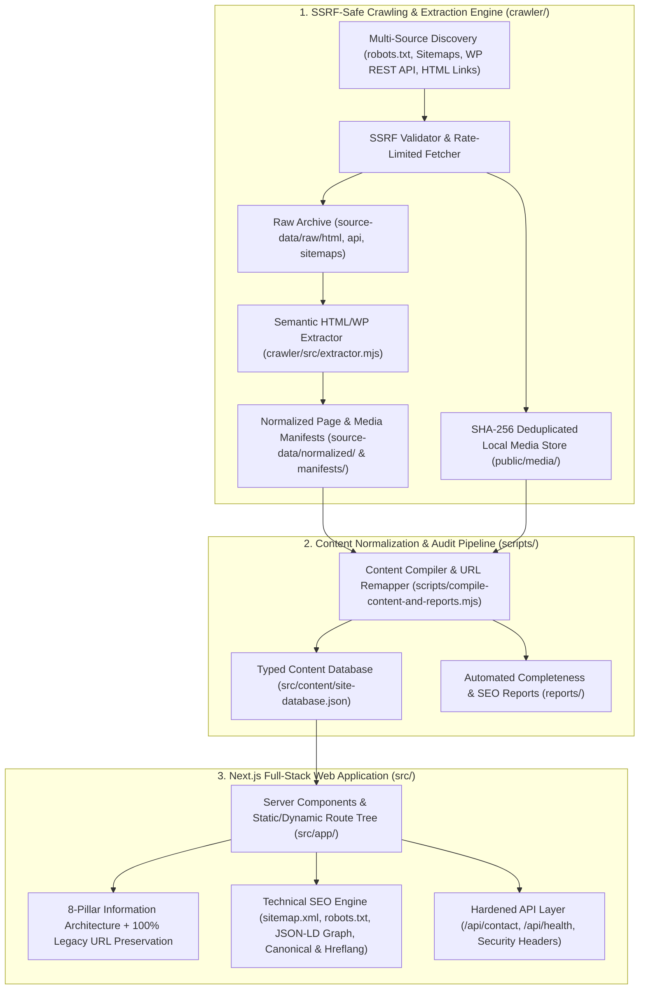

# System Architecture — Transilvania Cave Diving

## 1. Architectural Overview

The reconstructed **Transilvania Cave Diving** web application is engineered as a content-first, high-performance, full-stack **Next.js (App Router, React, TypeScript strict mode, Tailwind CSS)** platform.

## 2. Information Architecture & URL Routing Strategy

To satisfy both Section 7 (*New Information Architecture* with 8 clear top-level categories) and Section 12 (*SEO Equity & Legacy URL Preservation*), the application implements:

### 2.1 Top-Level Navigation Categories
1. **Acasă** (`/`) — Immersive presentation of Transilvania Cave Diving, key destinations in Moneasa & Mehedinți, technical services, and exploration heritage.
2. **Descoperă** (`/descopera`) — Hub for tourist attractions, caves, and karst systems:
   - Peștera Grota Ursului – Moneasa (`/grota-ursului`)
   - Peștera Liliecilor – Moneasa (`/pestera-liliecilor`, plus `/bat-cave` [EN] and `/denever-barlang` [HU])
   - Sistemul Carstic de la Moară (`/pestera-uscata-de-la-moara`, plus `/the-mill-karst-system` [EN] and `/a-malom-karsztrendszere` [HU])
   - Belvedere Moneasa & Cariera de Marmură (`/belvedere-moneasa`)
   - Stațiunea Balneoclimaterică Moneasa (`/statiunea-moneasa`)
3. **Aventuri și experiențe** (`/aventuri`) — Dedicated presentation of specialized outdoor and subterranean experiences:
   - Cave Diving & Peștera Isverna (`/visit-isverna` & `/cave-diving`)
   - Via Ferrata – Cetate Dezna (`/via-ferrata-cetate-dezna`)
   - Moneasa Adventure – Școala Altfel & Săptămâna Verde (`/moneasa-adventure`)
   - Speoturism & Canyoning (Grota Ursului, Peștera Șura Mare, Ponorici-Cioclovina, Munții Apuseni)
4. **Servicii** (`/servicii` & legacy `/blog`) — Speotourism organization, technical cave diving guidance, equipment distribution, commercial underwater works (dams, hydropower, search & recovery), and high-angle/confined-space works.
5. **Istorie și patrimoniu** (`/istorie-si-patrimoniu`) — Dedicated historical & scientific hub featuring:
   - Pionierul turismului montan: **Czárán Gyula (1847–1906)** (`/czaran-gyula`)
   - Istoria Stațiunii Balneoclimaterice Moneasa (1597–prezent) (`/statiunea-moneasa`)
   - Istoricul explorărilor speologice și scufundărilor subterane din România (1984–prezent)
6. **Jurnal** (`/jurnal`) — Complete editorial archive of all 36 articles, expedition programs, IANTD courses, speotourism guides, and technical equipment reviews, while keeping every legacy `/YYYY/MM/DD/[slug]` permalink active.
7. **Magazin** (`/magazin`) — Authorized equipment catalog (Fenix, TecLine, Ammonite System, Kwark, UR-Flex, Bauer Kompressoren, Ursuit, Si Tech, Shearwater) and Străița Bunicii local products, complete with ordering instructions, shipping policy, and OUG 34/2014 return policy.
8. **Contact** (`/contact`) — Official company details (`S.C. Transilvania Cave Diving S.R.L.`, CIF `39749631`, Reg. com. `J02/1309/2018`, Arad), direct phone/WhatsApp contacts, and a rate-limited, CSRF/honeypot-protected inquiry form (`/api/contact`).

### 2.2 Zero-Loss Legacy URL Routing & Redirect Map
- Every single original page and post URL (`/grota-ursului/`, `/pestera-liliecilor/`, `/2021/07/31/speologie-si-canyoning-in-muntii-sureanu/`, etc.) is served directly at its canonical path with zero broken links.
- New IA hub routes (`/descopera`, `/aventuri`, `/servicii`, `/istorie-si-patrimoniu`, `/jurnal`, `/cave-diving`) enrich navigation while cross-linking to the canonical destination and article URLs.
- Legacy WordPress aliases and nested paths are documented in `reports/redirect-map.csv` and enforced in `next.config.mjs`.

